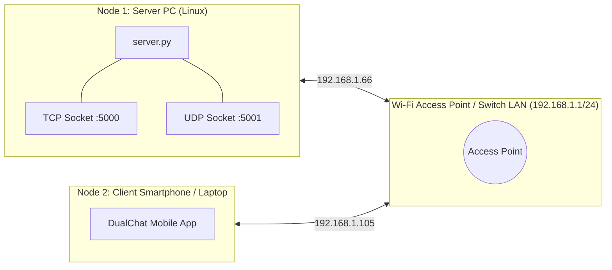

# BAB II: ARSITEKTUR SISTEM & TOPOLOGI JARINGAN
Mata Kuliah: Jaringan Komputer — Project Based Learning 2
Aplikasi: DualChat (Mobile & Desktop Multi-Client Messaging System)

---

## 2.1 Diagram Skematik Topologi Jaringan

Pengujian DualChat mendukung dua skenario arsitektur pengujian jaringan:

### Skenario A: Topologi Localhost & Android Emulator (Loopback Virtual Network)
```
+---------------------------------------------------------------------------------+
|                                HOST PC (Linux Fedora)                            |
|                                                                                 |
|   +-------------------------------------------------------------------------+   |
|   |                  DualChat Backend Server (server.py)                     |   |
|   |                  - TCP Listener: 0.0.0.0:5000 (SOCK_STREAM)             |   |
|   |                  - UDP Listener: 0.0.0.0:5001 (SOCK_DGRAM)              |   |
|   +-------------------------------------------------------------------------+   |
|                                    ^                                            |
|                                    | (Traversing Linux 'lo' loopback interface) |
|         +--------------------------+--------------------------+                 |
|         |                                                     |                 |
|   +--------------------------+               +--------------------------------+ |
|   | Python Benchmark / CLI   |               | Android Emulator (QEMU Virtual)| |
|   | - IP: 127.0.0.1          |               | - Gateway to Host: 10.0.2.2    | |
|   | - client.py / benchmark  |               | - DualChat Flutter Mobile App  | |
|   +--------------------------+               +--------------------------------+ |
+---------------------------------------------------------------------------------+
```

### Skenario B: Topologi Local Area Network (LAN Wi-Fi 2 Physical Devices)


---

## 2.2 Tabel Pengalamatan IP (IP Addressing Table)

| Komponen Jaringan | Node / Perangkat | Alamat IP | Subnet Mask | Port Digunakan | Antarmuka Fisik/Virtual |
| :--- | :--- | :--- | :--- | :--- | :--- |
| **Server TCP** | PC Host / Server | `127.0.0.1` / `192.168.1.66` | `255.255.255.0` | `5000` (TCP) | `lo` / `wlan0` / `eth0` |
| **Server UDP** | PC Host / Server | `127.0.0.1` / `192.168.1.66` | `255.255.255.0` | `5001` (UDP) | `lo` / `wlan0` / `eth0` |
| **Client 1 (Mobile)** | Android Emulator | `10.0.2.15` (Host: `10.0.2.2`)| `255.255.255.0` | Ephemeral (`50000+`)| `eth0` (QEMU SLIRP) |
| **Client 2 (Physical)**| Android HP / Laptop | `192.168.1.105` | `255.255.255.0` | Ephemeral (`50000+`)| `wlan0` (Wi-Fi 802.11ac)|
| **Client 3 (CLI Tester)**| PC Host (Terminal) | `127.0.0.1` | `255.0.0.0` | Ephemeral | `lo` (Loopback) |

---

## 2.3 Potongan Kode Kunci (Key Code Snippets) Inisialisasi Socket

### 1. Inisialisasi Socket TCP & UDP pada Backend Server (Python)
File: `transport.py`
```python
# Inisialisasi Socket TCP (SOCK_STREAM)
self.sock = socket.socket(socket.AF_INET, socket.SOCK_STREAM)
self.sock.setsockopt(socket.SOL_SOCKET, socket.SO_REUSEADDR, 1)
self.sock.bind((host, port))
self.sock.listen(128)
self.sock.setblocking(False)

# Inisialisasi Socket UDP (SOCK_DGRAM)
self.sock = socket.socket(socket.AF_INET, socket.SOCK_DGRAM)
self.sock.setsockopt(socket.SOL_SOCKET, socket.SO_REUSEADDR, 1)
self.sock.bind((host, port))
self.sock.setblocking(False)
```

### 2. Inisialisasi Socket TCP & UDP pada Mobile Client (Flutter / Dart)
File: `lib/services/dualchat_client.dart`
```dart
// Koneksi TCP (Socket byte-stream)
_tcpSocket = await Socket.connect(targetHost, targetPort, timeout: Duration(seconds: 3));
_tcpSocket!.listen(
  _onTcpDataReceived,
  onError: _onTcpError,
  onDone: _onTcpDone,
);

// Bind Socket UDP (Datagram socket)
_udpSocket = await RawDatagramSocket.bind(InternetAddress.anyIPv4, 0);
_udpSocket!.listen((RawSocketEvent event) {
  if (event == RawSocketEvent.read) {
    Datagram? dg = _udpSocket!.receive();
    if (dg != null) _processUdpDatagram(dg);
  }
});
```
